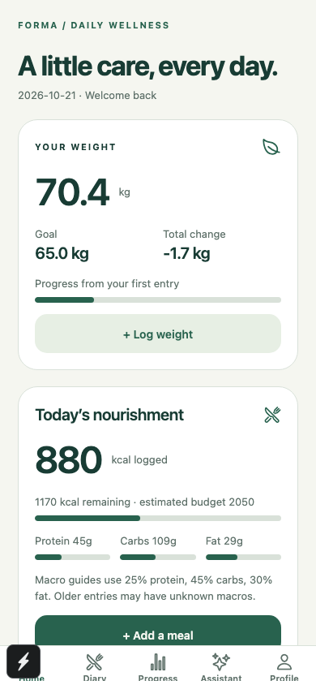
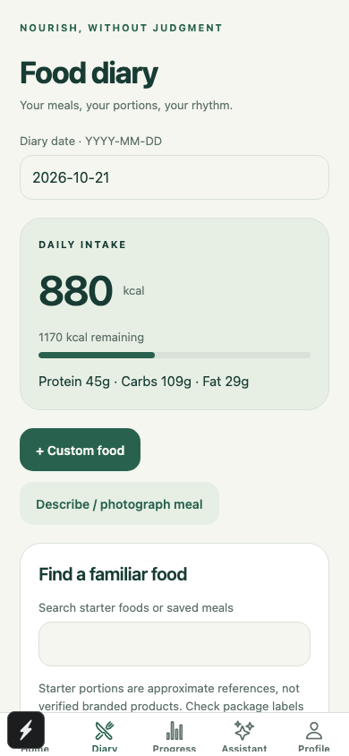
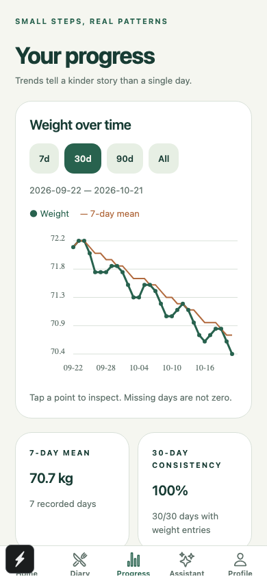
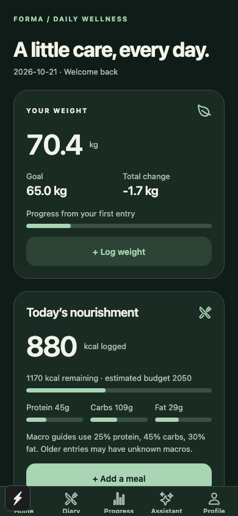
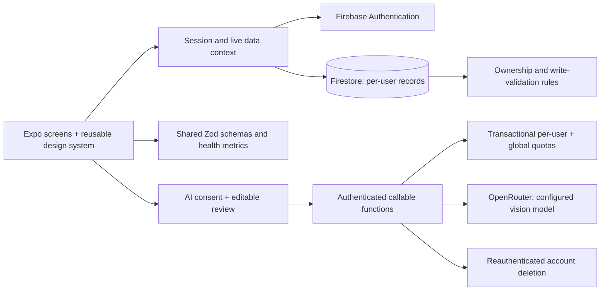

# Forma — health tracking at your pace

A bilingual React Native / Expo app for weight trends, food diaries, and consent-based AI nutrition support. Evolved from Weight Tracker while retaining its Firebase accounts and collection paths.

**Status: engineering beta candidate, not production approved.** Core tracking is implemented; live AI requires backend/provider configuration. Native App Check credential/device verification, physical-device QA, dependency remediation, and signed distribution are release gates. See [release checklist](docs/RELEASE.md) and [baseline audit](docs/AUDIT.md).

## Experience
- Five tabs: Home, Diary, Progress, Assistant, Profile.
- Adaptive sage/cream light theme and dark theme, accessible labels, touch-friendly forms, empty/loading/error states and tab haptics.
- Daily/historical weight entries, Android-compatible edit/delete forms, month calendar, kg/lb and height conversion, optional waist measurement.
- Interactive 7/30/90/all weight and nutrition charts, seven-calendar-day moving average, direction-aware goal progress, logging consistency and monthly counts.
- Meal categories, editable serving sizes, calories/macros, starter food search, frequent foods and favorite/custom meal templates.
- Adult goal setup with maintenance/gain/gradual loss modes, adjustable estimated calories and documented BMI limitations.
- Email/password sessions, registration, recovery, verified-email flow, private cloud sync, CSV/full JSON exports and reauthenticated account deletion.
- AI text/photo estimates, short conversational Q&A and weekly aggregate insights; estimates only enter the diary after explicit review and confirmation.

## Screenshots

Actual app screenshots use synthetic local emulator data; they do not represent real users. Browser mobile viewport captures are not native device test evidence.

  



## Stack and architecture

Expo SDK 54, Expo Router, React Native 0.81, React 19, strict TypeScript, Firebase Authentication/Firestore, callable Cloud Functions, Zod, Chart Kit, Expo Image Picker/Manipulator, Jest/Testing Library, Playwright, Firestore emulator and GitHub Actions. Firebase is retained to preserve existing accounts, real-time sync and operational simplicity.



UI lives in `app/`; reusable controls in `components/Wellness.tsx`; domain schemas/calculations in `shared/`; persistence, export and AI calls in `services/`; server code in `functions/src/`. No new global state framework or backend migration is required.

### Database design

| Path | Purpose |
| --- | --- |
| `users/{uid}` | Existing profile/settings; additive goals, units and consent |
| `users/{uid}/weights/{id}` | Canonical kg, calendar date, optional waist cm; old IDs retained |
| `users/{uid}/weightDays/{YYYY-MM-DD}` | Transactional date claim for new clients |
| `users/{uid}/foods/{id}` | Total portion calories/macros, quantity, category, date, provenance |
| `users/{uid}/templates/{id}` | User-created favorite foods and meal templates |
| `_aiQuota/{uid}` | Server-only request counters |
| `_aiBudget/daily` | Server-only global daily counter |
| `_accountBlocks/{uid}` | Temporary deletion tombstone; TTL required |

Dates are local calendar dates, not UTC truncations. New clients use an atomic date claim; legacy duplicates remain stored, shown in history and included in exports. Trend statistics use one deterministic record per date. Legacy foods have unknown macros until edited. [Metric and compatibility details](docs/ARCHITECTURE.md).

## Local setup

Use Node 22 (`.nvmrc`). No production credentials are committed.

```sh
npm ci
cp .env.example .env
# Fill in Firebase WEB project configuration, never a provider secret.
npm start
```

Enable Email/Password auth in your own Firebase project and add your web origin to authorized domains. For a safe local demo, follow [emulator setup](docs/DEPLOYMENT.md). The app displays a setup screen if Firebase configuration is absent.

## Checks

```sh
npm run check
npm ci --prefix functions
npm run build --prefix functions
npm test --prefix functions
npx firebase-tools@14.22.0 emulators:exec --only firestore --project demo-weight-tracker 'npm run test:rules'
npx expo export --platform all
```

Java 21 is required for the emulator. CI runs app type/lint/tests, server build/tests, iOS/Android/web bundle export, and real emulator security tests. The browser smoke flow is documented in [testing](docs/TESTING.md). Bundle generation is not native runtime testing.

## AI and security

Provider secrets only exist in Secret Manager. AI is disabled by default; no model is selected automatically. Requests require authentication, verified email in production, stored consent and App Check. Input/output Zod validation, strict JSON schema, 12-second attempt timeouts, one bounded transient retry, 1,600 output tokens, 10 requests/user/UTC day, 2/minute, 200/day globally and 2 function instances constrain usage. Requests explicitly require non-training, zero-retention provider routes and price ceilings; no eligible route fails closed. These controls are not a guaranteed currency spending cap.

Photos are downscaled to 1,024px JPEG without EXIF and limited in size. No photo or conversation is written to Firestore. Users control sharing; only weekly aggregate numbers are sent automatically when explicitly requested. Nutrition is approximate. General education safeguards are defense in depth, not clinically validated moderation.

If an `EXPO_PUBLIC_OPENROUTER_API_KEY` was ever used in a published build, treat that provider key as exposed and revoke it in the provider console. Firebase web configuration is public project identification; authorization comes from Auth and Rules.

[AI tradeoffs and setup](docs/AI.md) · [deployment](docs/DEPLOYMENT.md) · [security/release gates](docs/RELEASE.md) · [privacy draft](docs/PRIVACY.md) · [terms draft](docs/TERMS.md)

## Roadmap and honest limits

- Configure and device-test the implemented native App Check bridge; production native AI stays blocked when attestation is unconfigured.
- Upgrade the Expo/RN SDK line with native regression testing to resolve outstanding inherited dependency advisories.
- Paginate long histories, add indexed date-range subscriptions, and measure startup, memory and Firestore costs at realistic scale. Current real-time listeners load user histories.
- Add a server-side USDA catalog integration or verified licensed dataset. Starter portions are approximate and never labeled verified.
- Optional activity integrations, richer measurements, multi-item meal composition, configurable macro goals, clinical safety review, crash reporting and accessible native chart navigation.
- Publish reviewed legal pages, configure deletion support URL, validate signed builds on iOS/Android, then request approval for beta distribution.

## Resume bullets

- Refactored an Expo/TypeScript health app around shared validation, authenticated Firestore services, and a reusable bilingual light/dark design system spanning five navigation tabs.
- Built a consent-based nutrition AI pipeline with structured text/photo results, editable confirmation, server-only secrets, transactional quotas, provider privacy filters, retries, and timeouts.
- Added automated health-calculation, UI, session, backend, and Firestore isolation tests plus GitHub Actions checks and reproducible iOS, Android, and web bundle generation.

No adoption, revenue, speedup or reliability numbers are claimed without measurements.
